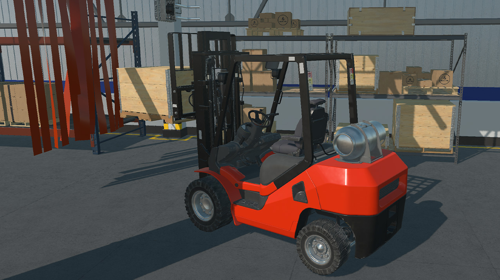
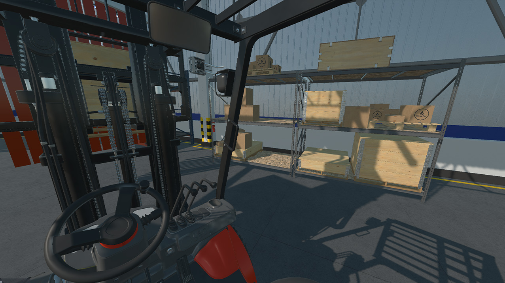

# Physics Sample

### Live Demo here: [Physics Sample](https://vehiclephysics.z6.web.core.windows.net/)

This sample shows how to use Evergine's **Jolt Physics** integration: a forklift in a warehouse that can pick up a pallet from a rack and carry it. It uses simulation-ready assets with real-world scale and masses, as a base for physics-driven simulation scenarios.

## What it shows

- **Wheeled vehicle:** engine, rear-wheel drive and Ackermann steering.
- **Constraints with motors:** a two-stage mast on sliders, a tilt hinge and forks that open and close.
- **Rigid bodies:** pallets and boxes with their real masses, on static racks made of box colliders.
- **Soft body:** a strip curtain the forklift drives through.
- **Physics queries:** a sphere cast keeps the camera from going through walls.
- Physics authored in the scene and prefabs from Evergine Studio.

## How to use

**Keyboard and mouse**

* **W, A, S, D or ← → ↑ ↓:** Drive.
* **Space:** Parking brake.
* **E / Q:** Lift / lower the forks.
* **R / F:** Tilt the mast forward / back.
* **X / Z:** Open / close the forks.
* **C:** Change camera.
* **Right mouse button / wheel:** Look around / zoom.
* **H:** Hide the help.

**Touch**

* **Lower left of the screen:** stick to drive.
* **Lower right of the screen:** stick to lift and open the forks.
* **Elsewhere:** drag to look around, pinch to zoom.

## Build and Run

- Required Visual Studio 2026 with .NET10 support

## 3D assets

Models from **[NVIDIA SimReady](https://huggingface.co/spaces/nvidia/simready-central)** (forklift, warehouse, racks and pallets), licensed under **[CC BY 4.0](https://creativecommons.org/licenses/by/4.0/)**. Adapted for this sample: converted to glTF, textures resized and compressed to KTX2, and physics set up for Jolt.

----

Powered by **[Evergine](https://evergine.com)**

LET'S CONNECT!

- [Youtube](https://www.youtube.com/c/Evergine)
- [Twitter](https://x.com/EvergineTeam)
- [Blog](https://evergine.com/news/)
